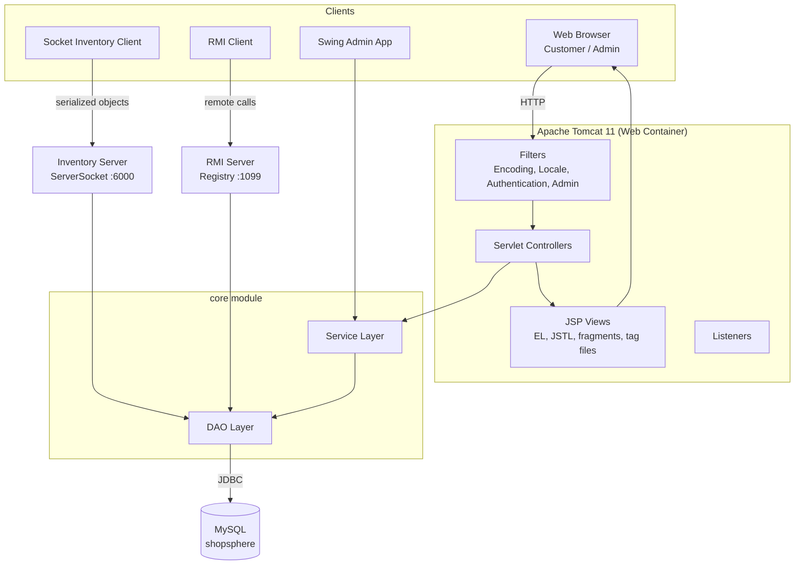
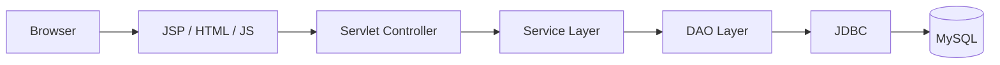
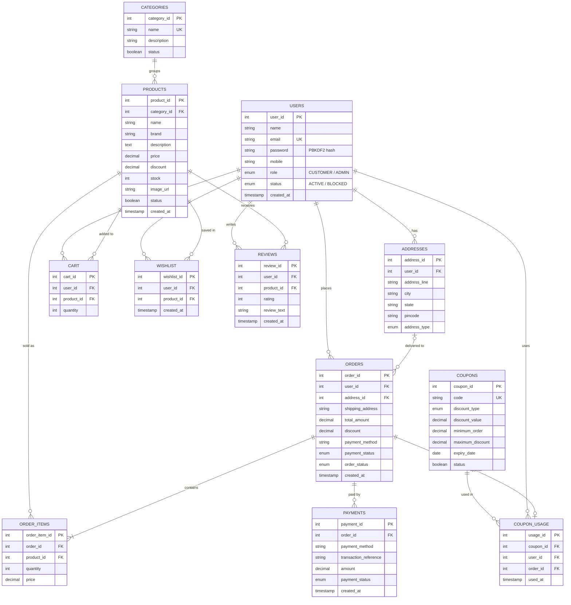
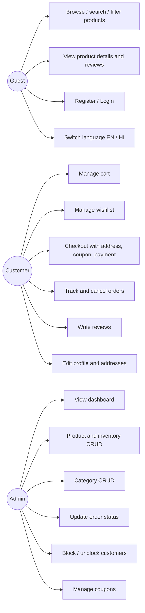
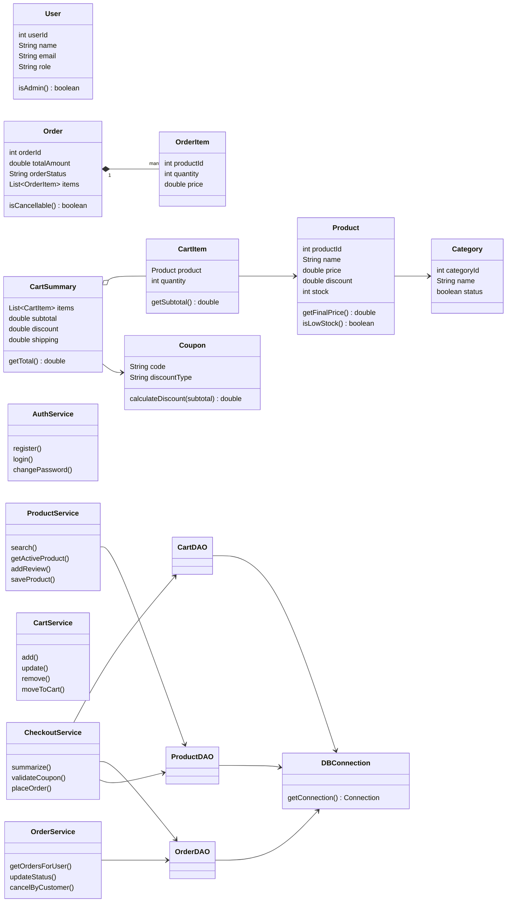
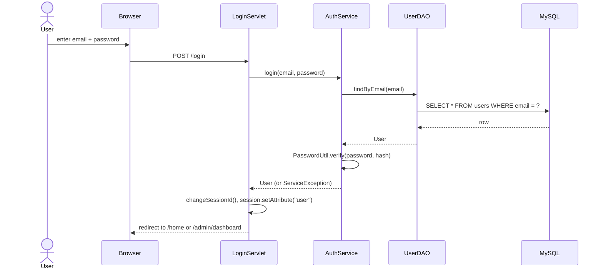
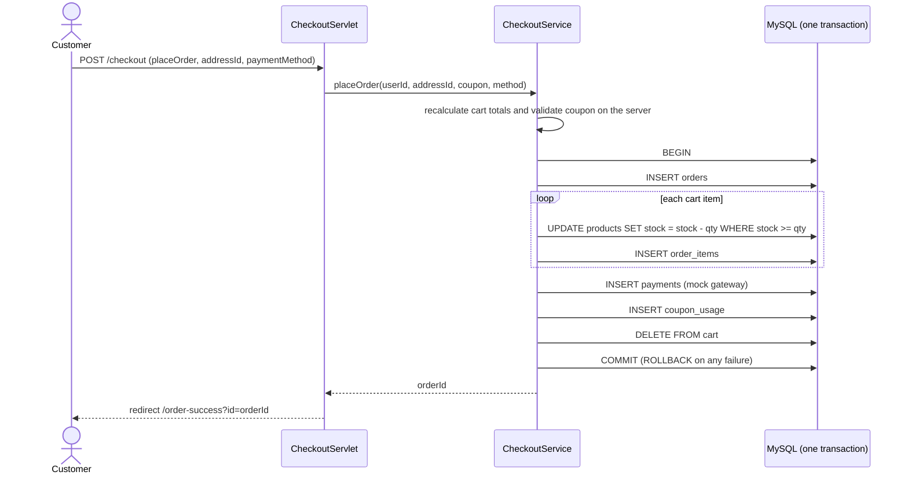

# ShopSphere – Design Diagrams

GitHub renders these Mermaid diagrams automatically.

## 1. System Architecture

## 2. N-Tier Request Flow (web store)

## 3. Entity Relationship Diagram

## 4. Use Cases

## 5. Class Diagram (core)

## 6. Login Sequence

## 7. Place-Order Sequence

